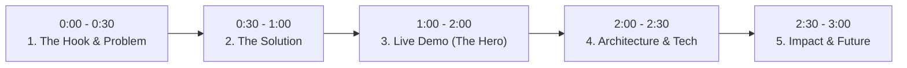

# 🏆 3-Minute Hackathon Winning Pitch Guide

Hackathons are won during the 3-minute pitch. Judges listen to 20+ pitches in a row; clarity, energy, and a working demo beat technical complexity every time.

---

## 🎯 The 6-Slide Pitch Structure (3 Minutes Total)

---

### Slide 1: The Hook & The Pain Point (30 seconds)
- **Goal**: Make judges nod their heads and understand the urgency.
- **Formula**: *"Did you know that [Target Audience] wastes [X hours / \$Y dollars] every week trying to [Painful Task]?"*
- **Avoid**: Vague buzzwords. State the exact person suffering from this problem today.

---

### Slide 2: The Solution & Value Proposition (30 seconds)
- **Goal**: Introduce your product in one crisp sentence.
- **Formula**: *"We built **[App Name]** — an autonomous system that takes [Messy Input] and instantly delivers [Verified High-Value Outcome] in under 2 seconds."*
- Highlight your **Secret Sauce**: Why is your approach 10x better than existing manual or legacy tools?

---

### Slide 3: The Live Demo (60 seconds — The Core)
- **Rule #1**: **NEVER live-type long sentences.** Use the preset 1-click buttons already built into the UI.
- **Rule #2**: Tell the story through the persona: *"Watch what happens when Sarah, a data analyst, uploads her weekly report..."*
- Show:
  1. Triggering the action.
  2. The rapid computation / AI processing.
  3. The dynamic output (graphs, metrics, actionable summary).
- Have a 15-second screen recording backup video ready on your desktop in case conference Wi-Fi cuts out!

---

### Slide 4: Technical Architecture & Innovation (30 seconds)
- Show a simple diagram:
  `Client UI (Next.js/Tailwind) -> Serverless API Handler -> LLM / Gemini Engine + Mock Fallback -> Real-Time Analytics`
- Mention 1–2 technical challenges your team solved (e.g., latency reduction, structured schema validation, error recovery).

---

### Slide 5: Real-World Impact & Business Model (20 seconds)
- **Who pays for this?** (B2B SaaS, API usage, enterprise licensing).
- **Market Size / Impact metric**: (e.g. saves 8 hours/week per operator, or improves triage speed by 65%).

---

### Slide 6: The Vision & Roadmap (10 seconds)
- Where does this go in the next 3 months? (Integrations with Slack/ERP, mobile app, multi-agent workflows).
- End with confidence: *"Thank you! We are Team [Name], and we'd love to take your questions."*

---

## 💡 Top 3 Q&A Defenses for Judges

1. **"How is this different from ChatGPT / standard LLMs?"**
   > *"ChatGPT is a general chat interface. Our solution is an end-to-end domain workflow engine: it enforces structured outputs, runs real-time metrics verification, and plugs directly into existing operational databases without prompt engineering."*

2. **"What happens if the AI hallucinates or the API goes down?"**
   > *"We engineered a dual-layer validation layer: confidence scoring threshold checks and high-availability fallback caching to ensure zero system downtime."*

3. **"How do you plan to scale this?"**
   > *"Our architecture is completely stateless and serverless on Next.js/Vercel, meaning it scales horizontally with zero infrastructure management overhead."*
